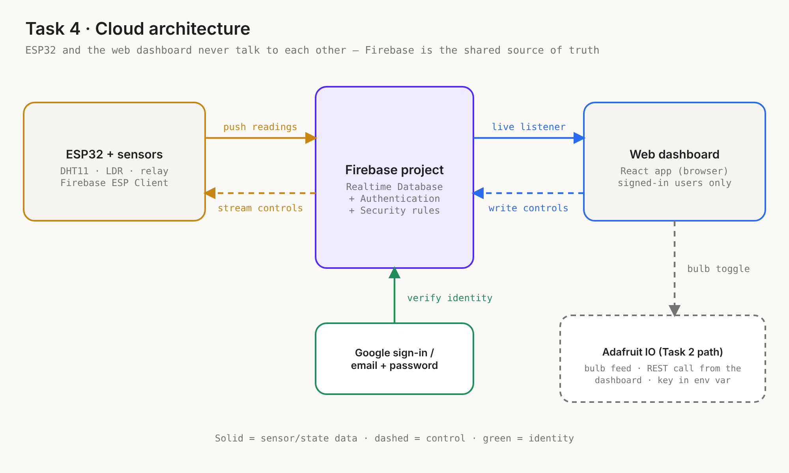

# Forge_IOT

Five-task IoT build on the **ESP32**, one folder per task. Each task keeps the same outcome — a light turning on — and changes only the path the command takes.

| # | Task | Path of the command | Folder |
|---|------|---------------------|--------|
| 1 | ESP32 web server + HTML LED control | Browser → ESP32 (HTTP, local network) | [`Task-01-ESP32-WebServer-LED`](Task-01-ESP32-WebServer-LED) |
| 2 | Adafruit IO + MQTT relay | Dashboard → broker → ESP32 (MQTT, internet) | [`Task-02-AdafruitIO-MQTT-Relay`](Task-02-AdafruitIO-MQTT-Relay) |
| 3 | IFTTT voice automation | Voice → IFTTT → Adafruit IO → ESP32 | [`Task-03-IFTTT-Voice-Automation`](Task-03-IFTTT-Voice-Automation) |
| 4 | Firebase dashboard (IaaS / PaaS / SaaS / BaaS, auth) | Login-protected web app ↔ Firebase RTDB ↔ ESP32 | [`Task-04-Firebase-Dashboard`](Task-04-Firebase-Dashboard) |
| 5 | Logging, LDR automation, CSV export | Sensors → Firebase history → chart → CSV | [`Task-05-Firebase-Logging-Automation-CSV`](Task-05-Firebase-Logging-Automation-CSV) |

Each task README follows the same outline: objective, concepts, hardware and software, wiring, how it works, code, recreation steps, problems and learnings.

## Hardware used
ESP32 DevKit · 5 V single-channel relay module (active-LOW) · DHT11 · LDR + fixed resistor · jumper wires · a mains bulb on the relay's COM/NO contacts (Tasks 2, 4, 5).

> **Mains safety.** The bulb circuit is 230 V. Only the relay's switched contacts touch it; keep the ESP32 side on low voltage, use an enclosure, and do not work on it while powered.

## Status of the code — please read
The sketches and the dashboard were **reconstructed from the portfolio write-up** (the snippets and screenshots published there). They are written to match what the write-up describes, but **have not been re-flashed or re-run after reconstruction**. Treat them as a faithful starting point: flash, test, and adjust pins or thresholds for your own board.
Each file says so in its header comment where it applies.

## Secrets
No credentials are committed. Sketches use `YOUR_…` placeholders; the dashboard reads `VITE_*` values from a local, git-ignored `.env` (see `Task-04-Firebase-Dashboard/dashboard/.env.example`).

## Portfolio write-up
The full narrative with diagrams, screenshots and videos is on the portfolio: <https://github.com/rsd-06/Portfolio> (ProtoSem → Week 7).
