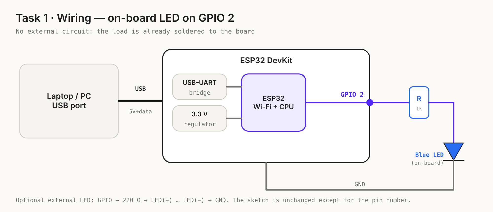
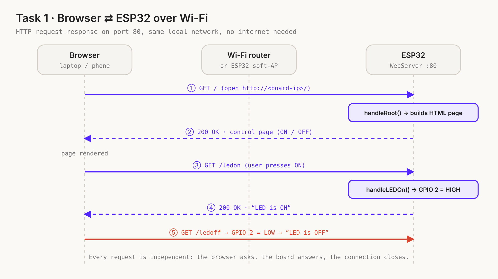
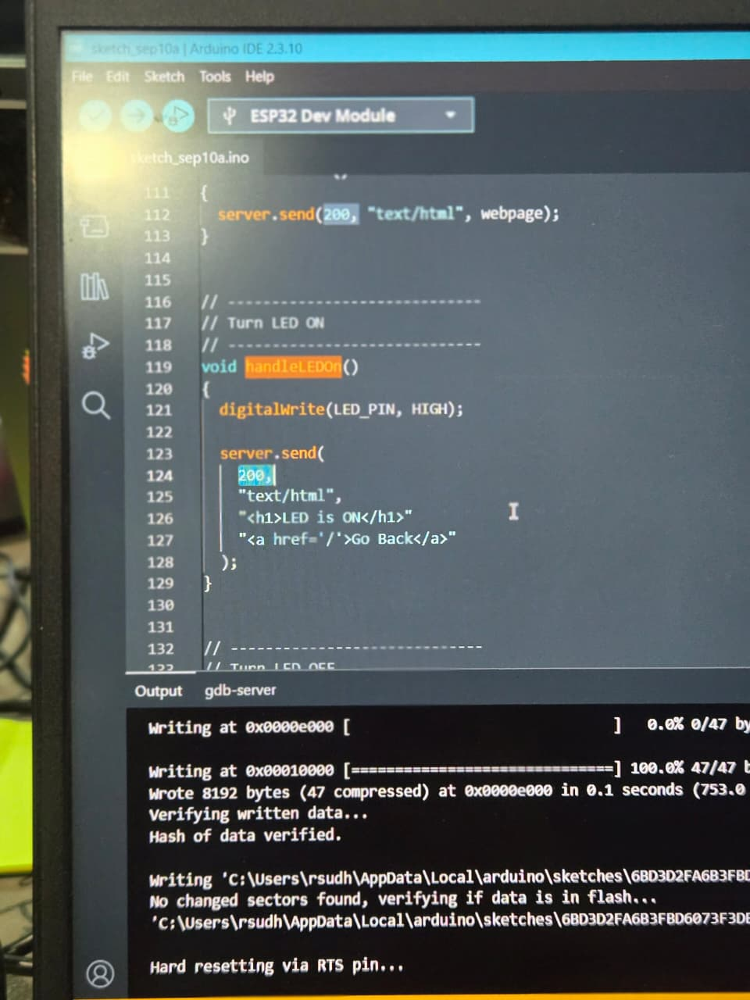
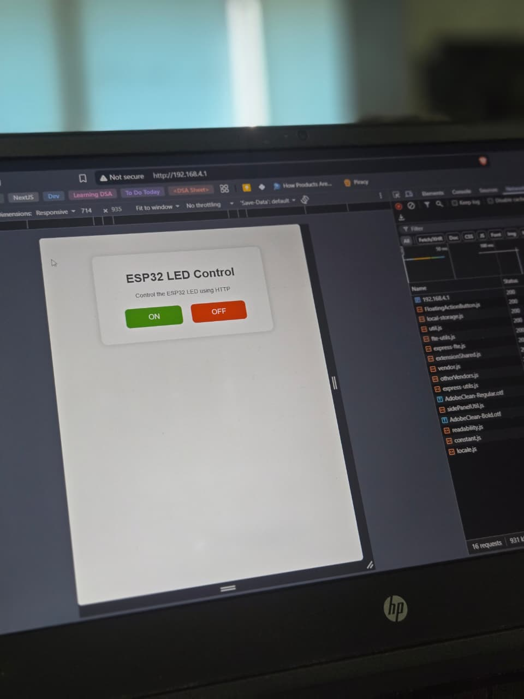
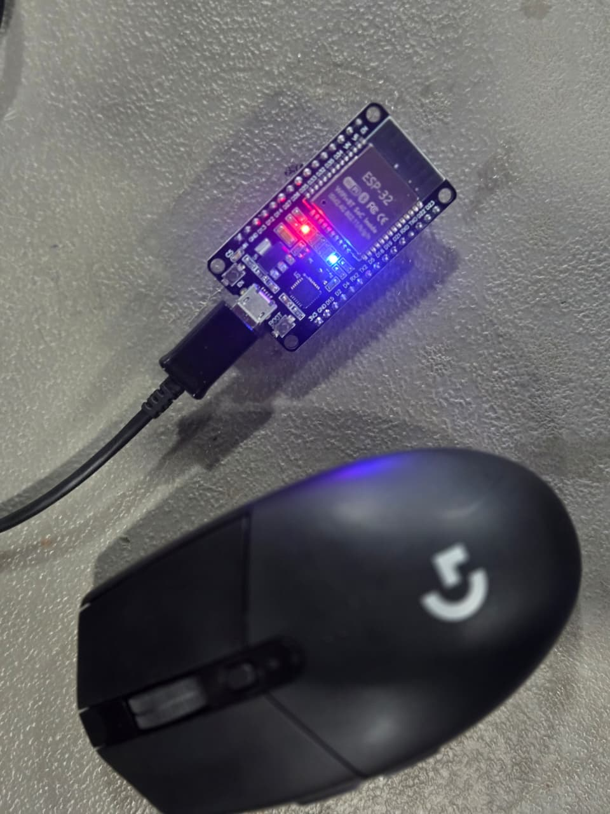
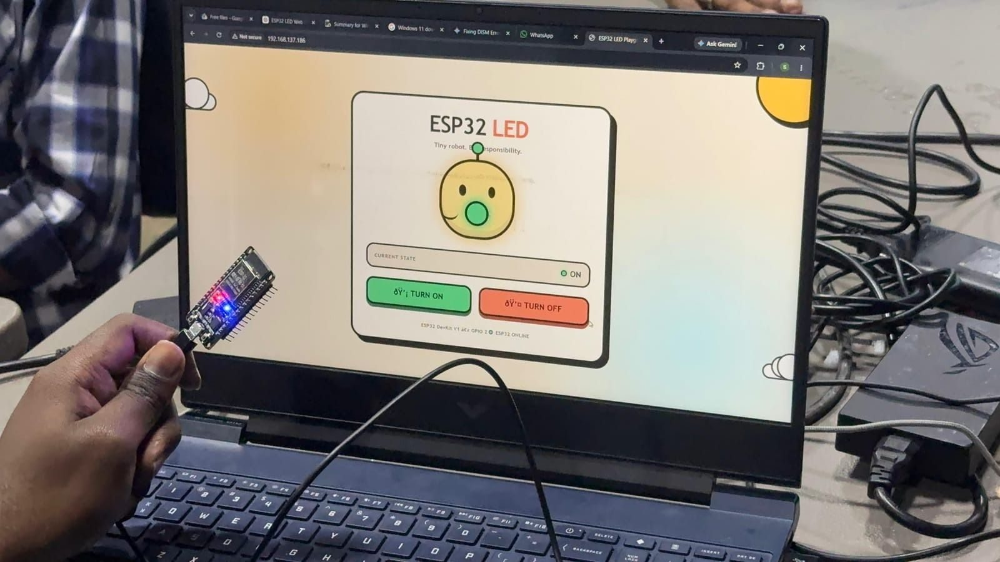
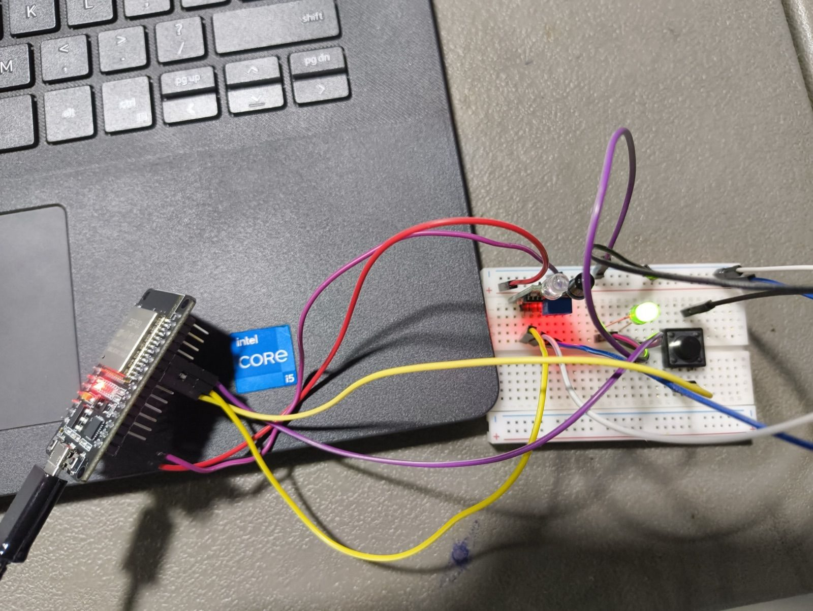

# Task 01 — ESP32 Web Server with HTML LED Control

## Objective
Serve a control page from the ESP32 itself and use it to switch the on-board LED (GPIO 2) from any browser on the same network.

## Concepts
- **HTTP request/response:** the browser sends `GET /on` or `GET /off`; the ESP32 changes the pin and replies with the page.
- **`WebServer` library:** registers handlers for URL paths (`server.on("/on", …)`) and runs on port 80.
- **Local network only:** the board has a private address (e.g. `192.168.x.x`); nothing is reachable from outside the router.

## Hardware and software
ESP32 DevKit, USB cable · Arduino IDE, ESP32 board package, `WiFi.h` + `WebServer.h` (bundled with the core), Serial Monitor at 115200.

## Wiring
No external wiring — the load is the blue LED already on the board, driven from **GPIO 2**.
Optional external LED: GPIO → 220 Ω → LED(+) … LED(−) → GND.

## How it works

1. The ESP32 joins Wi-Fi (credentials in the sketch) and prints its IP on the Serial Monitor.
2. Opening that IP returns the HTML page (stored in flash, `PROGMEM`).
3. The ON/OFF buttons are links to `/on` and `/off`; the handlers set GPIO 2 HIGH/LOW and send the page back.

## Code
[`Task_01_ESP32_WebServer_LED.ino`](Task_01_ESP32_WebServer_LED.ino) — includes a commented soft-AP alternative (the portfolio screenshot was taken on the soft-AP address `192.168.4.1`).

## Recreate it
1. Install the ESP32 board package; select your ESP32 board and port.
2. Put your 2.4 GHz SSID/password into the sketch.
3. Upload, open Serial Monitor, note the IP.
4. Open the IP in a browser and press ON / OFF.

## Photos and screenshots
| Upload | Web UI | Board |
|---|---|---|
|  |  |  |

| Styled page, board in hand (station mode, `192.168.137.186`) | Breadboard: ESP32, relay module, LED, push button |
|---|---|
|  |  |

**Videos:** [`images/demo-led-web-board.mp4`](images/demo-led-web-board.mp4) — page at `192.168.4.1` next to the board. The original demo is on the portfolio page.

## Problems and learnings
- ESP32 supports **2.4 GHz** Wi-Fi only; a 5 GHz-only SSID never connects.
- The page is part of the firmware, so changing a colour means re-flashing.
- Works only while the phone/laptop is on the same network — the motivation for Task 2.
