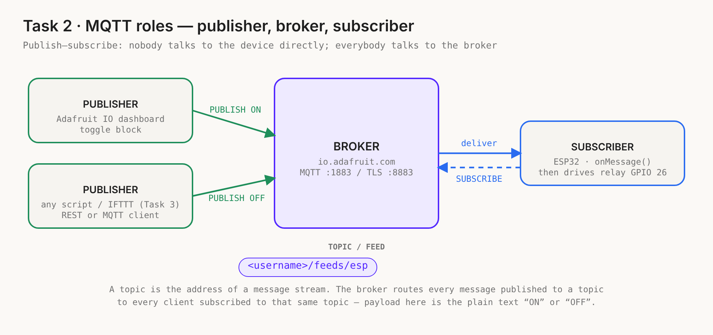
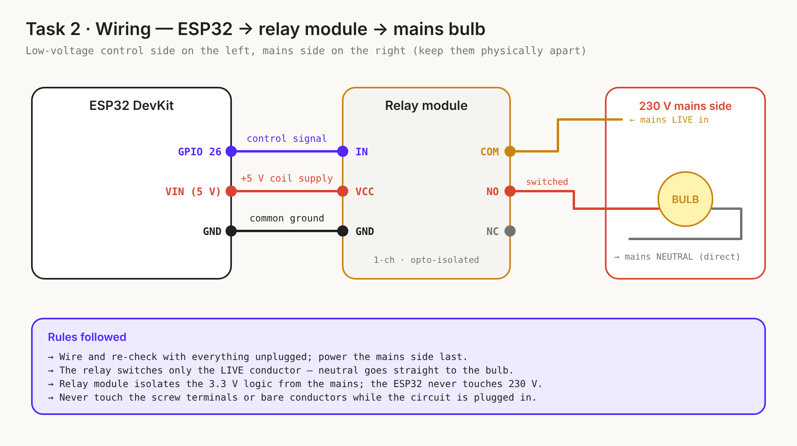
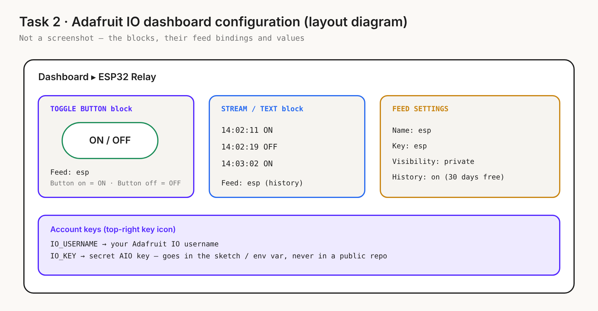
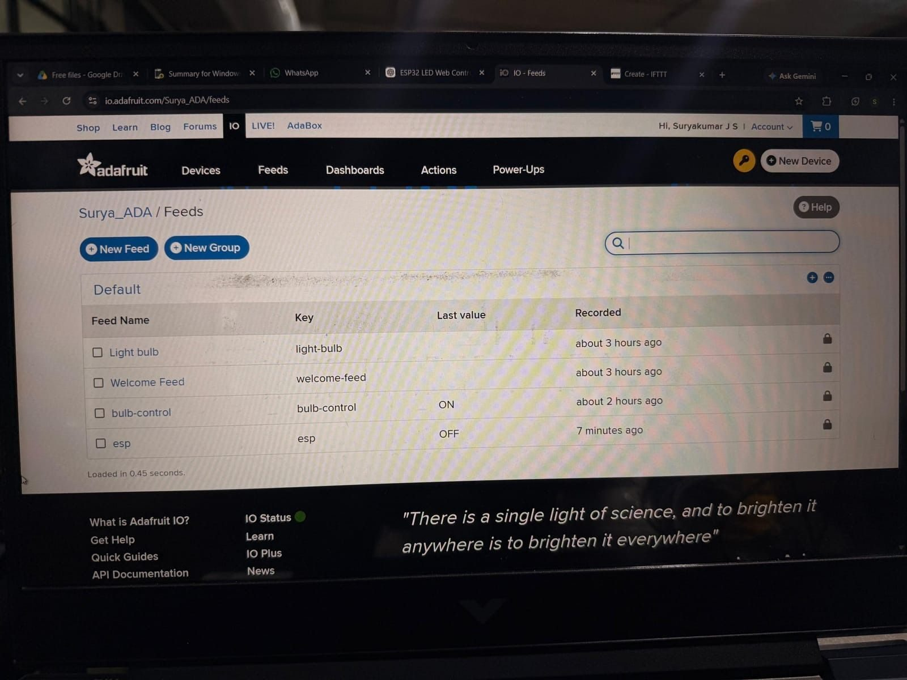
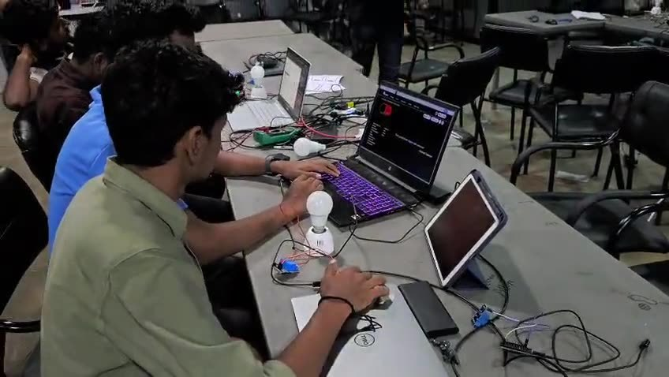
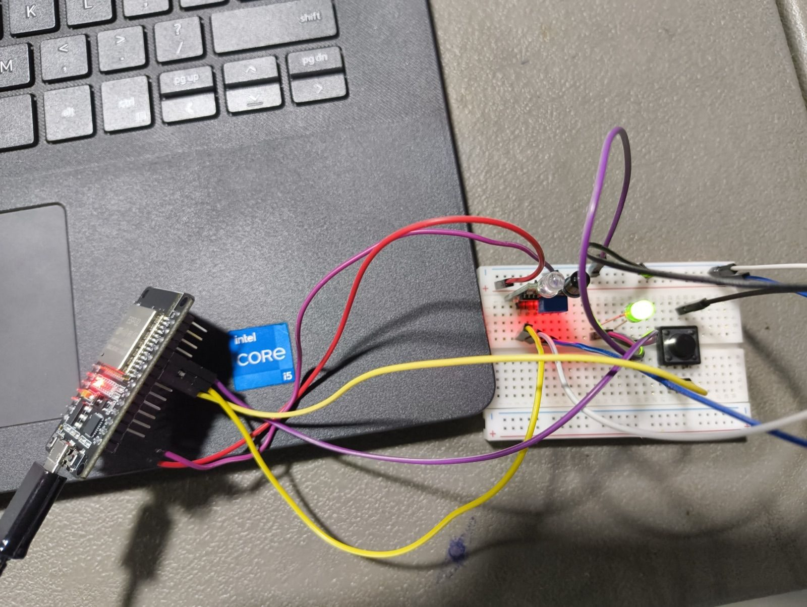

# Task 02 — Adafruit IO and MQTT Relay Control

## Objective
Switch a relay-driven mains bulb from anywhere on the internet using a hosted MQTT broker and dashboard.

## Concepts
- **MQTT** is publish/subscribe: clients never talk to each other, only to a **broker**.
- **Publisher** sends a message to a **topic**; **subscriber** receives everything on topics it subscribed to; the **broker** routes.
- **Adafruit IO** is the hosted broker + dashboard (SaaS). A **feed** maps to a topic: `<username>/feeds/esp`.
- The dashboard toggle publishes `ON`/`OFF`; the ESP32 is a subscriber.

## Hardware and software
ESP32, 5 V relay module (active-LOW depending on module), mains bulb + holder. Arduino IDE, library **Adafruit IO Arduino** (pulls in Adafruit MQTT and ArduinoHttpClient).

## Wiring
Relay IN → GPIO 26, VCC → 5 V (VIN), GND → GND. Mains live → COM, NO → bulb, neutral straight to the bulb.

## Adafruit IO setup
1. Create an account, open **Feeds** → create a feed named `esp`.
2. **Dashboards** → new dashboard → add a **Toggle** block bound to `esp` (ON value `ON`, OFF value `OFF`).
3. Copy your username and active key (**keep the key out of git**).

## Communication flow
Dashboard toggle → Adafruit IO broker → feed `esp` → ESP32 `onMessage` → `digitalWrite(26, …)`.

## Code
[`Task_02_Adafruit_MQTT_Relay.ino`](Task_02_Adafruit_MQTT_Relay.ino) — placeholders for Wi-Fi and Adafruit credentials. If your relay is active-LOW, swap HIGH/LOW in `handleMessage`.

## Adafruit IO Feeds page

## Photos
| Bulb ON | Bulb OFF |
|---|---|
|  |  |

Relay module on the breadboard: 

**Video:** [`images/demo-bulb-phone.mp4`](images/demo-bulb-phone.mp4) — the bulb switching while the operator works from a phone.

## Problems and learnings
- Credentials in firmware are a liability; use placeholders in git.
- Latency is around a second because of the cloud round-trip.
- You depend on a broker you do not control.
