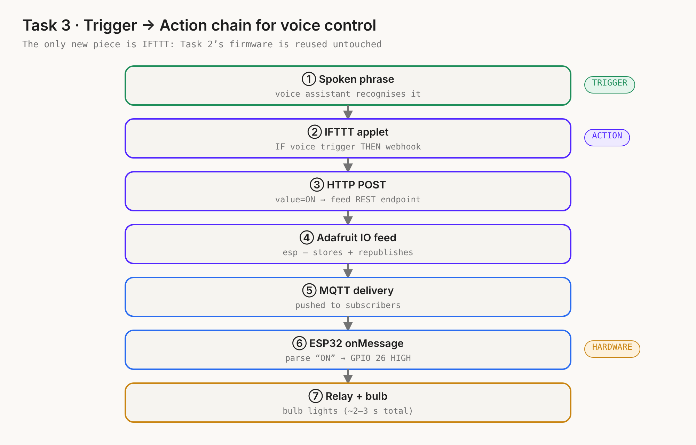
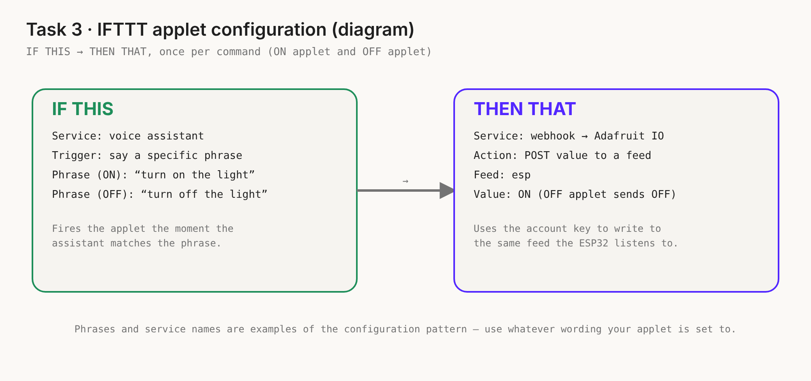

# Task 03 — IFTTT Voice Automation

## Objective
Turn the bulb on and off by voice **without changing the Task 2 firmware**.

> **Firmware:** this task reuses [`../Task-02-AdafruitIO-MQTT-Relay/Task_02_Adafruit_MQTT_Relay.ino`](../Task-02-AdafruitIO-MQTT-Relay/Task_02_Adafruit_MQTT_Relay.ino) unchanged. That is the point of the task — the boundary drawn in Task 2 (feed `esp`) already accepts commands from any source.

## Concepts
- **IFTTT** ("If This Then That") chains a **trigger** (this) to an **action** (that).
- Trigger: a voice phrase through the Google Assistant service. Action: **Adafruit IO → Send data to Adafruit IO**.
- Adafruit IO is the shared point: IFTTT is another publisher on feed `esp`.

## Applet setup
Create two applets:

| Applet | If This | Then That |
|---|---|---|
| Light on | Google Assistant, phrase e.g. "turn on the light" | Adafruit IO → feed `esp`, data `ON` |
| Light off | Google Assistant, phrase e.g. "turn off the light" | Adafruit IO → feed `esp`, data `OFF` |

## Data flow
Voice → assistant → IFTTT applet → Adafruit IO feed `esp` → (MQTT) → ESP32 → relay.

## Test matrix (expected results)
| Phrase | Feed value | Expected |
|---|---|---|
| "turn on the light" | `ON` | Relay closes, bulb on |
| "turn off the light" | `OFF` | Relay opens, bulb off |

## Learnings
- Voice added **no firmware change**, but 2–3 s latency (more hops).
- Any hop failing breaks the chain; the Adafruit IO activity feed is the quickest place to check.
- IFTTT free tier limits applets and runs.

## Adafruit IO feed (real screenshot)

## To add
Screenshots of your own applets and a short voice demo video — put them in `images/`.
