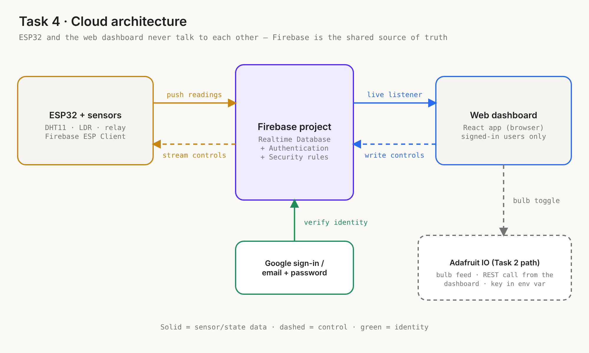
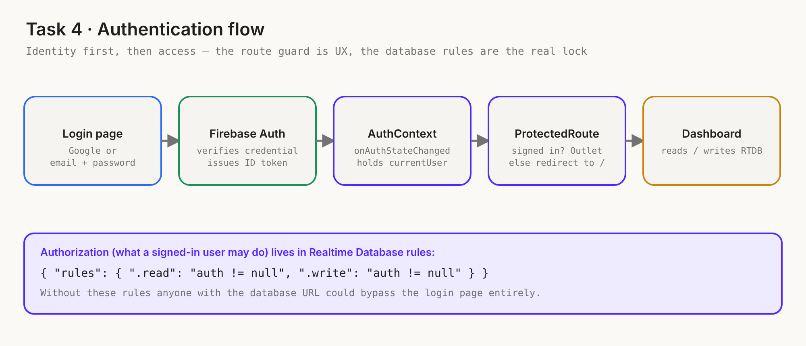
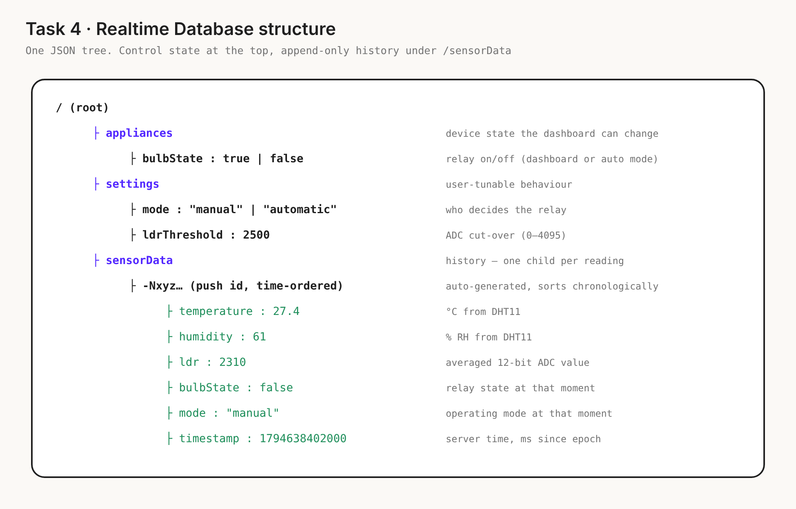
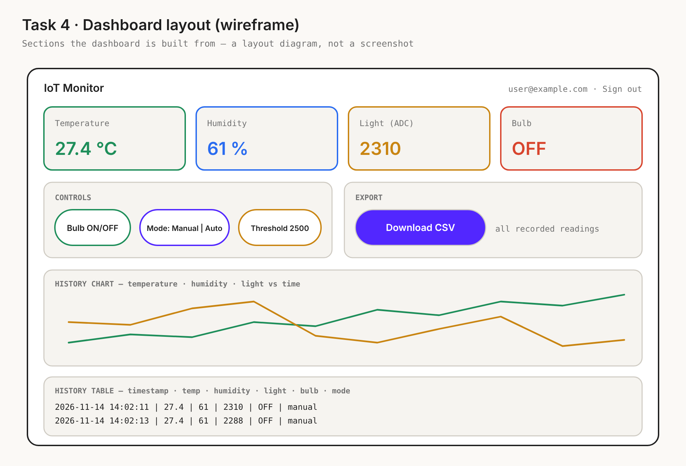

# Task 04 — Firebase Dashboard, Cloud Concepts and Authentication

## Objective
Show live sensor telemetry on a **login-protected** web dashboard and let it control the relay, with Firebase as the backend.

## Cloud computing concepts
Cloud computing is renting compute, storage and services over the internet instead of owning them. Service models, from most to least work for you:

| Model | You manage | Provider manages | Examples | In this project |
|---|---|---|---|---|
| **IaaS** | OS, runtime, app, data | Hardware, virtualisation | EC2, Compute Engine, Azure VMs | Could host your own MQTT broker |
| **PaaS** | App + data | OS, runtime, scaling | App Engine, Heroku, Vercel | Could deploy a custom API/dashboard host |
| **SaaS** | Just use it | Everything | Gmail, Adafruit IO, IFTTT | Tasks 2 and 3 |
| **BaaS** | Front end + rules | DB, auth, storage, hosting | **Firebase**, Supabase, Amplify | This task |

- **Cloud platform:** Google's Firebase. **Database:** Realtime Database (a JSON tree synced to clients over streams).
- **Cloud dashboard:** the React app in [`dashboard/`](dashboard).



## Authentication and authorization
- **Authentication** = *who are you?* — Firebase Authentication (email + password).
- **Authorization** = *what may you do?* — Realtime Database **rules**: [`database.rules.json`](database.rules.json) requires `auth != null` for reads and writes, so an anonymous visitor gets nothing.



## Database structure


- `/live` — latest temperature, humidity, light, bulb state
- `/appliances` — commands from the dashboard (the ESP32 streams this)
- `/sensorData/<pushId>` — history (used in Task 5)

## Firebase setup
1. Create a project → add a **Web app** (copy the config).
2. **Authentication** → enable Email/Password → add a user for the dashboard and one for the device.
3. **Realtime Database** → create → paste `database.rules.json` into Rules.
4. Put the web config in `dashboard/.env` (from `.env.example`) and the API key/URL/user in the firmware.

## Run
```bash
cd dashboard
cp .env.example .env     # fill in
npm install
npm run dev
```
Firmware: [`firmware/Task_04_Firebase_Live_Telemetry.ino`](firmware/Task_04_Firebase_Live_Telemetry.ino) (library: *Firebase ESP Client* by mobizt, *DHT sensor library*).

## Dashboard layout


## Security note
`VITE_*` variables are bundled into the browser. The Adafruit IO key in `.env.example` is optional and is the documented trade-off: a key shipped to the browser is visible to anyone who can open the app. A server or Cloud Function proxy is the proper fix.

## Problems and learnings
- Rules default to open or closed depending on the mode; always verify with a logged-out request.
- A second `FirebaseData` object is needed for the stream, separate from the one used for writes.
- BaaS removed the need to write and host a server.
