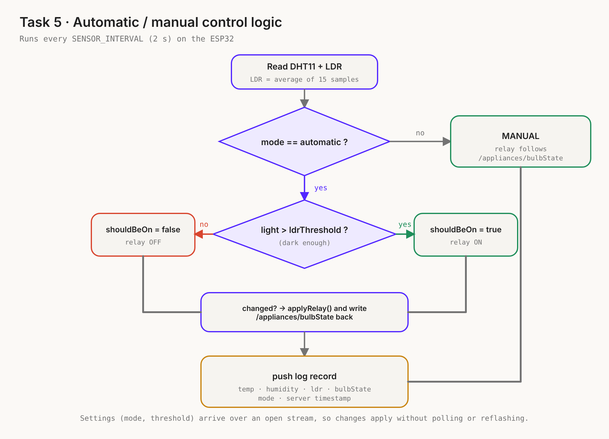
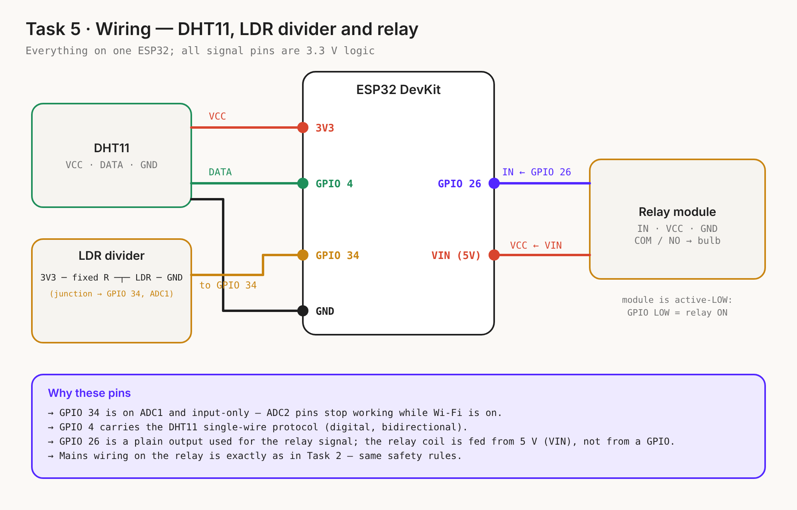
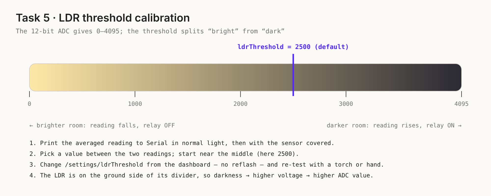
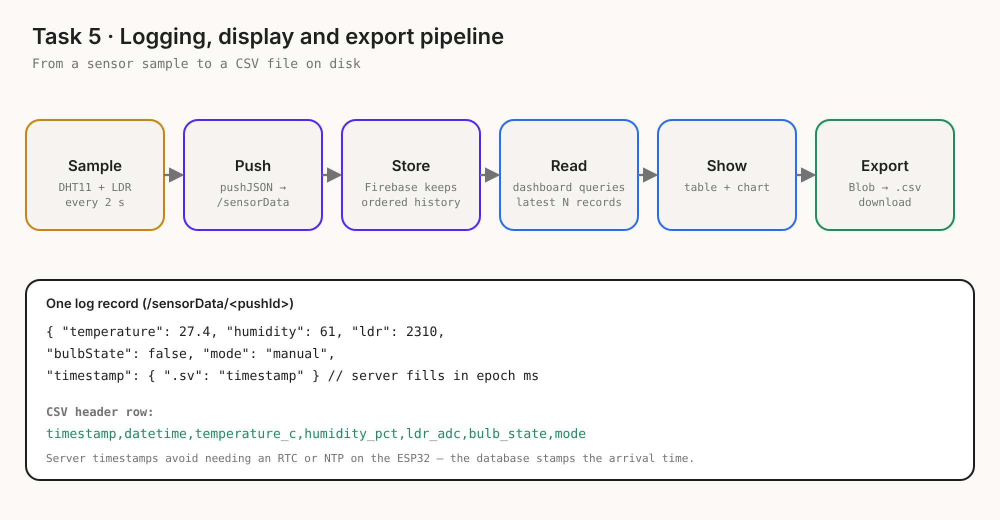
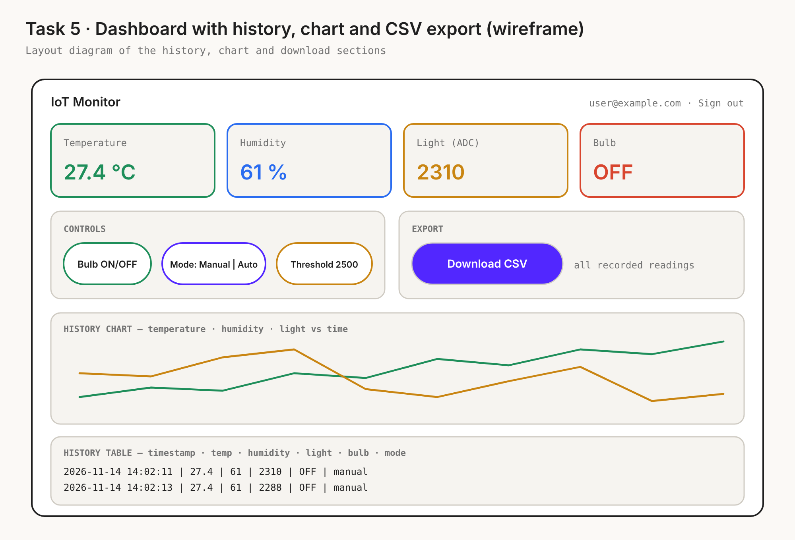
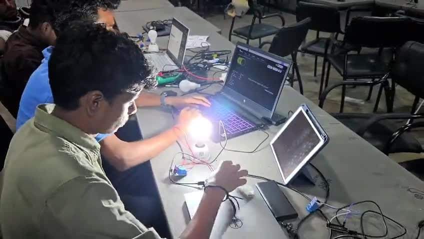
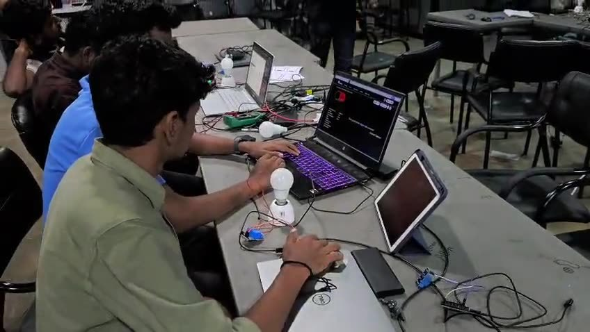

# Task 05 — Logging, LDR Automation and CSV Export

## Objective
Let the room control the light: read a **DHT11** and an **LDR**, switch the bulb **manually or automatically**, log every reading with a timestamp to Firebase, show history on the dashboard, and export it as CSV.



## Sensors
- **DHT11** on GPIO 4 — temperature (°C) and humidity (%).
- **LDR** voltage divider on **GPIO 34** (ADC1) — analog 0–4095. Wired as 3V3 → LDR → node → fixed resistor → GND, so **a higher reading means darker**.



## Modes and logic
- **Manual:** the dashboard sets the bulb; sensors only report.
- **Automatic:** `shouldBeOn = (light > ldrThreshold)` (default 2500; the dashboard can change it through `/settings/ldrThreshold`). Dark → bulb on; bright → off.
- The relay is **active-LOW** on GPIO 26.



**Calibration:** read the LDR in Serial in bright and dim conditions, pick a value between, and set `ldrThreshold`.

## Logging
Every sample interval (2 s) the sketch pushes a record to `/sensorData`:

```json
{ "temperature": 27.4, "humidity": 61, "ldr": 2740, "bulbState": "ON", "mode": "automatic", "timestamp": { ".sv": "timestamp" } }
```

`push()` creates a unique, time-ordered key; `.sv: timestamp` makes the **server** set the time, so it is correct even without an RTC/NTP on the ESP32.



## History, chart and CSV
The dashboard queries `/sensorData` ordered by `timestamp`, draws a chart and a table, and **Export CSV** maps those fields to the CSV columns and builds a file from the records in the browser (Blob download). Utility: [`../Task-04-Firebase-Dashboard/dashboard/src/utils/csv.js`](../Task-04-Firebase-Dashboard/dashboard/src/utils/csv.js).

Example layout (illustrative values):

```csv
timestamp,datetime,temperature_c,humidity_pct,ldr_adc,bulb_state,mode
1794638402000,2026-11-14T06:40:02.000Z,27.4,61,1850,OFF,automatic
1794638408000,2026-11-14T06:40:08.000Z,27.5,60,2810,ON,automatic
```



## Code
[`Task_05_Firebase_Logging_Automation.ino`](Task_05_Firebase_Logging_Automation.ino) · dashboard code is shared with Task 4.

## Photos
| Bulb ON | Bulb OFF |
|---|---|
|  |  |

## Limitations and future improvements
- Logging every 2 s grows the database quickly — add pruning, down-sampling or a longer interval.
- A single global threshold flickers near the boundary — add hysteresis (two thresholds).
- Any signed-in user can write; tighten rules per role or per path.
- The DHT11 is slow and coarse; a DHT22 or BME280 is better.
